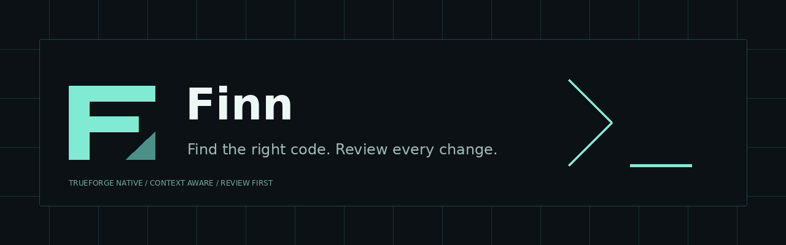

<p align="center"></p>

# Finn

Coding agents need the right context and a safe way to change files. Finn combines
a Rust repository-intelligence engine with a TrueForge-owned agent loop and a
VS Code review surface. Models propose changes; you decide what reaches disk.

[Architecture](docs/architecture.md) · [Demo](docs/demo.md) · [Security](SECURITY.md) · [Contributing](CONTRIBUTING.md)

## Status

Pre-release. The implementation is being verified against real MCP transports and
a real VS Code extension host. A live coding-agent demo additionally requires a
working model configured in TrueForge. Do not confuse passing test doubles with
successful live-model execution. See [the scorecard](docs/scorecard.md) for evidence
and remaining verification.

## Run locally

Requires Node **22.14+**, stable Rust, Git and VS Code **1.95+**. Everything runs on
your machine. No accounts, hosted Finn backend or Marketplace publication needed.

```bash
git clone https://github.com/atharhive/finn.git
cd finn
npm ci
npm run build:engine
npm run build
npm run trueforge
```

Open the URL printed by TrueForge, normally `http://localhost:8790`. Add a model
provider in TrueForge's settings and copy a configured model reference. Finn never
needs your provider API key.

<details>
<summary>Load Finn in VS Code</summary>

1. Open this repository in VS Code and trust the workspace.
2. Press **F5** and choose **Finn Extension**.
3. In the Extension Development Host, open the repository you want to work on.
4. Set `finn.model` to the model reference from TrueForge. Set
   `finn.fallbackModel` if you want a second configured model for failover.
5. Open the Finn activity-bar view or run **Finn: Open Agent**.
6. For an inline edit, select code and press **Ctrl+I** / **Cmd+I**.

TrueForge must run on the same machine as the extension host. The default
`finn.trueforgeUrl` is `http://127.0.0.1:8790`.

To install a package instead of using F5:

```bash
npm run package -- --target linux-x64
code --install-extension finn-agent-linux-x64-0.1.0.vsix
```

Build on the target platform or use a matching CI artifact. The package includes a
native Rust binary; a Linux package does not run on macOS or Windows. Use
`darwin-arm64` or `win32-x64` when packaging on those platforms.

</details>

## Working model

- **Inline edits:** selection plus instruction, proposed changes in the editor.
- **Agent mode:** one request, tool-driven file discovery and multi-file proposals.
- **Context:** task-aware selection, explicit mentions, budget and selection reasons.
- **Review:** per-hunk accept/reject, preview and stale-content protection.
- **Undo:** restore a Finn-accepted change without silently overwriting later edits.
- **Control:** streamed events, cancellation, actionable errors and configured fallback.

Source proposals remain in memory until reviewed. A restart discards pending work.
Already accepted human edits are not silently reverted by cancellation. Terminal
commands require a separate explicit approval and run as your local user; they are
not sandboxed. Read [SECURITY.md](SECURITY.md) before approving commands.

## Verify

```bash
cargo build -p finn_mcp
npm run check
npm run test:rust
npm run lint:rust
npm run test:vscode
npm audit --omit=dev
```

On Linux, the VS Code host test needs Xvfb plus GTK, NSS and audio runtime libraries.
It starts a real extension development host, not a mocked `vscode` module.

A real model turn through a running TrueForge is opt-in and skipped without both
variables:

```bash
FINN_TRUEFORGE_LIVE_URL=http://127.0.0.1:8790 FINN_LIVE_MODEL=<provider>/<model> \
  npx vitest run tests/agent/live-model.test.ts
```

It streams a real turn, requires actual editor MCP tool calls, checks that nothing
reaches disk before a reviewed hunk is accepted, and exercises undo and mid-stream
cancellation. It never fabricates provider responses.

<details>
<summary>Module boundaries and tests</summary>

- `src/agent`: TrueForge agent configuration, sessions, turns, events and recovery.
- `src/workspace`: path guards, authenticated MCP tools, proposal/undo lifecycle.
- `src/context`: task-aware context assembly using the Rust engine.
- `src/extension`: native commands, editor selection, chat and review UI.
- `crates`: scanner, dependency graph and context-selection foundation.
- `mcp`: Rust repository-intelligence MCP service.
- `tests`: behaviour, transport, security and host smoke tests.

No source file is edited because a model requested it. Only an explicit hunk
acceptance applies a source proposal. Approved terminal commands are a separate
execution boundary and can write files; use a clean isolated clone for a demo.

</details>

## Forge-a-thon demo

The official tasks use `pallets/flask` tag `3.1.3`. Preparation and independent
verification instructions are in [docs/demo.md](docs/demo.md). No benchmark solution
is embedded in Finn's production code. The demo must show actual TrueForge
sessions, real diffs and real command outcomes. Model credentials and an honest
recording remain the operator's responsibility.

## Starting point and licensing

Finn has fresh Git history, not a claim of from-scratch authorship. The reused
repository-intelligence foundation, original copyright notices and exact upstream
revision are declared in [THIRD_PARTY_NOTICES.md](THIRD_PARTY_NOTICES.md). Changes
from that foundation add the TrueForge client, task-aware context bridge, secure
editor tools and native review workflow, while removing the inherited synthetic
agent-scheduling surface. New Finn code is MIT licensed; upstream and dependency
licences remain in force.
