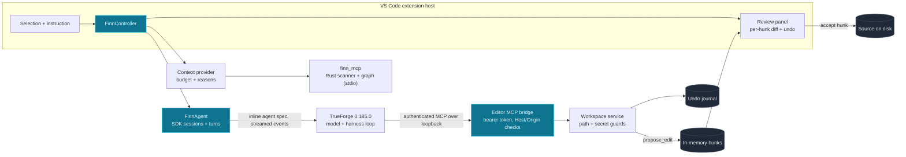

<p align="center"></p>

<h1 align="center">Finn</h1>

<p align="center"><strong>A review-first coding agent for VS Code, running on TrueFoundry TrueForge.</strong><br/>
Task-aware context from a Rust engine. Every model edit lands as a proposal you accept hunk by hunk.</p>

<p align="center">
  
  
  
  
  
  
</p>

<p align="center">
  
  
  
  
  
  
  
  
</p>

> [!IMPORTANT]
> Finn holds no provider key and never calls a model provider. All reasoning, tool execution and sessions belong to **TrueForge**, which must be running locally. Without a configured model in TrueForge, Finn shows an explicit setup state instead of pretending to work.

> [!WARNING]
> Approved terminal commands run as your local user and are **not** sandboxed. Review every command and use a disposable clone for untrusted work. Details in [SECURITY.md](SECURITY.md).

## Why this exists

Coding agents fail in two boring ways: they read the wrong files, and they write before you look. Finn treats both as design problems rather than prompt suggestions.

- **Retrieval is a subsystem, not a guess.** A Rust scanner, dependency graph and budgeted selector assemble task-aware context with per-file reasons and an enforced token budget.
- **Edits are proposals, never writes.** The agent's only write tool stages full-content replacements in memory. Nothing touches disk until you accept a hunk.
- **The harness is borrowed, not rebuilt.** TrueForge owns sessions, turns, streaming, approvals and compaction. Finn supplies the editor, the context and the review boundary.
- **Cancellation is honest.** Stopping a turn kills the remote turn, discards pending proposals and leaves already-accepted edits alone.
- **Failures are visible.** Missing model, dead provider, stale file and rejected approval all surface as errors, not silent mocks.



<details>
<summary><strong>Request path, tool surface and invariants</strong></summary>

**Turn sequence**

1. `FinnController` asks the context provider for a bundle bounded by `finn.contextBudget`.
2. `FinnAgent` registers a per-process editor MCP server in TrueForge and verifies the registration read-back.
3. It creates or reuses one inline session and streams a turn, forwarding `text`, `status`, `tool`, `context` and `done` events.
4. The model calls editor tools; proposals accumulate in memory.
5. The panel renders hunks; acceptance applies exactly what was reviewed.

**Editor MCP tools**

| Tool | Purpose | Writes? |
| --- | --- | --- |
| `assemble_context` | Task-aware retrieval with budget and reasons | No |
| `read_file` | Bounded read inside the workspace root | No |
| `search_workspace` | Ignore-aware content search | No |
| `propose_edit` | Full replacement proposal with original hash | No, memory only |
| `run_command` | Bounded process, explicit human approval | Yes, by design |

**Invariants enforced in code and tests**

- Canonical path resolution denies traversal, symlink and hardlink escapes, `.git` internals, `.env` files and credential paths.
- The MCP bridge binds `127.0.0.1` only, requires a per-process bearer token, rejects hostile `Host`/`Origin` and oversized bodies, and supports the Streamable HTTP transport with real SDK sessions.
- A proposal whose file changed after staging is refused rather than overwriting your edits.
- Cancellation and disposal never revert accepted human work.
- Retry and fallback happen only before any tool invocation, so a tool is never replayed.

</details>

## Verified state

These are the gates this revision actually passes. Every number was produced by running the command on the commit that introduced this file.

| Gate | Command | Result |
| --- | --- | --- |
| TypeScript, strict | `npm run typecheck` | clean, no diagnostics |
| Unit, protocol and security specs | `npx vitest run` | **89 passed**, 7 opt-in skipped |
| Live model round trip | `npx vitest run tests/agent/live-model.test.ts` | **2 passed** against real TrueForge |
| Rust workspace | `npm run test:rust` | passed |
| Rust lint | `npm run lint:rust` | fmt + clippy clean |
| Dependency audit | `npm audit --omit=dev` | no high or critical |
| Extension bundle | `npm run package -- --target linux-x64` | VSIX built, 2.4 MB |

### What the live round trip actually proves

`tests/agent/live-model.test.ts` is skipped unless `FINN_TRUEFORGE_LIVE_URL` and `FINN_LIVE_MODEL` are both set, so it can never run by accident on a machine without a harness. When enabled, it drives a real model through TrueForge and asserts that text streams as `model.message.delta` events, that the model calls `read_file` and `propose_edit` over the authenticated MCP bridge, that the file on disk stays byte-identical while the proposal is pending, that accepting a hunk writes the reviewed change, that `undo` restores the original bytes, and that cancelling a second streaming turn rejects with no proposals and no file changes.

Provider responses are never fabricated. Mocks exist only in HTTP contract tests.

## Forge-a-thon

Finn was built for **Forge-a-thon at Techfest, IIT Bombay**, powered by **TrueFoundry TrueForge**. The competition fixes one repository, `pallets/flask` at tag `3.1.3`, and three tasks that must be demonstrated live.

| Task | Requirement | Mechanical verification |
| --- | --- | --- |
| **A** inline edit | Treat `off` and `n` as false, case-insensitively, and document every false value | **passed**, `off/OFF/oFf/n/N` false, truthy cases intact |
| **B** agent mode | Add a built-in `flask config` command with masked JSON, tests and docs, without naming files | **passed**, 4 files across `src/`, `tests/`, `docs/`, `flask --help` lists it |
| **C** resilience | Bad provider must produce a clear error and leave the workspace clean | **passed**, error in 0.5 s, zero proposals, no file changes |

Verification is independent of the agent: `scripts/prepare-demo.mjs` pins the checkout, `scripts/verify-demo.mjs` re-runs the acceptance probes and hashes the tree before and after. Full runbook in [docs/demo.md](docs/demo.md); evidence ledger in [docs/scorecard.md](docs/scorecard.md).

### Reproduce the fixed tasks

```bash
node scripts/prepare-demo.mjs --dir "$HOME/finn-demo-take-1"
node scripts/verify-demo.mjs --dir "$HOME/finn-demo-take-1" --task a \
  --output "$HOME/finn-demo-take-1/a-result.json"
node scripts/verify-demo.mjs --dir "$HOME/finn-demo-take-1" --task b \
  --baseline "$HOME/finn-demo-take-1/b-before.json" \
  --output "$HOME/finn-demo-take-1/b-result.json"
```

The harness never writes a task solution. It prepares, probes and hashes; the edits must come from Finn through TrueForge.

## Run locally

Requires Node **22.14+**, stable Rust, Git and VS Code **1.95+**. Everything runs on your machine; there is no hosted Finn backend.

```bash
git clone https://github.com/atharhive/finn.git
cd finn
npm ci
npm run build:engine
npm run build
npm run trueforge
```

Open the URL TrueForge prints, normally `http://127.0.0.1:8790`, add a model provider in its settings and copy a configured model reference.

<details>
<summary><strong>Load Finn in VS Code</strong></summary>

1. Open this repository in VS Code and trust the workspace.
2. Press **F5** and choose **Finn Extension**.
3. In the Extension Development Host, open the repository you want to work on.
4. Set `finn.model` to the model reference from TrueForge, and optionally `finn.fallbackModel`.
5. Open the Finn activity-bar view, or run **Finn: Open Agent**.
6. For an inline edit, select code and press **Ctrl+I** / **Cmd+I**.

TrueForge must run on the same machine as the extension host. To install a packaged build instead of pressing F5:

```bash
npm run package -- --target linux-x64
code --install-extension finn-agent-linux-x64-0.1.0.vsix
```

The package bundles a native Rust binary, so build on the target platform: `linux-x64`, `darwin-arm64` or `win32-x64`.

</details>

### Settings

| Setting | Default | Meaning |
| --- | --- | --- |
| `finn.trueforgeUrl` | `http://127.0.0.1:8790` | Local TrueForge server |
| `finn.model` | empty | Configured model reference, for example `provider/model` |
| `finn.fallbackModel` | empty | Second configured reference for verified failover |
| `finn.contextBudget` | `8000` | Conservative context token budget |
| `finn.turnTimeoutSeconds` | `900` | Time allowed for one agent turn |
| `finn.enginePath` | empty | Override the packaged `finn_mcp` binary |

> [!TIP]
> Run **Finn: Restart Connections** after changing the model, the harness URL or the workspace folder. It rebuilds the MCP bridge and verifies registration again.

## Module map

| Path | Responsibility |
| --- | --- |
| `src/agent` | TrueForge sessions, turns, event streaming, retry, fallback, cancellation |
| `src/workspace` | Path guards, MCP bridge, proposals, per-hunk review, undo journal, approved commands |
| `src/context` | Task-aware assembly over the Rust engine with budgets and reasons |
| `src/extension` | Commands, selection flow, webview protocol, CSP, diff previews |
| `crates` | Scanner, dependency graph and context-selection foundation |
| `mcp` | Repository-intelligence MCP service used by the context provider |
| `tests` | Behaviour, transport, security, host smoke and opt-in live specs |

Contracts live in `src/contracts.ts` and are shared by all four modules, so the extension can be tested without a display and the agent without an editor.

## Credits

Built at **Techfest, IIT Bombay** for the **Forge-a-thon**, on top of **TrueFoundry TrueForge**. Thanks to TrueFoundry for a genuinely local harness with real session, streaming and MCP semantics, and to the Techfest organisers for a problem statement that rewards engineering rather than stunts. Thanks also to the VS Code extension API maintainers and the Rust MCP ecosystem, whose primitives saved us from inventing a worse version of them.

## From Ink to Finn

Ink is my earlier project, and Finn exists because of what it taught me.

I wrote Ink to answer a question that kept slowing me down: in a repository nobody has read end to end, which files actually matter for this task? It grew into a Rust engine that scans a codebase, builds a dependency graph and selects context. It won an **IBM hackathon**, and that win paid for **$1,600 of IBM TechXchange tickets**. It also taught me the harder lesson, the one that made this repository necessary: retrieval is not an agent. Ink could point at the right file, but the loop around it was scripted, so it always looked busy without ever earning enough trust to change code on its own.

When Forge-a-thon asked for a coding agent on top of TrueForge, I did not want to throw that engine away. The scanner and graph are mine, they work, and rewriting them would have been vanity. So I kept my own work and rebuilt the parts I had gotten wrong around it.

| Concern | Ink | Finn |
| --- | --- | --- |
| Agent loop | Scripted orchestration inside the MCP service | TrueForge owns sessions, turns, tools, streaming, approvals and compaction |
| Writes | Tool-level edits | In-memory proposals, per-hunk human acceptance, undo journal |
| Safety | Workspace scan boundaries | Canonical paths, symlink and hardlink rejection, `.git` and credential denial, bearer-authenticated loopback MCP with `Host` and `Origin` checks |
| Context | Retrieval results | Budgeted bundles with per-file reasons and explicit `@file` / `@symbol` mentions |
| Interface | Panel front end | Native commands, `Ctrl+I` inline edits, diff previews, streamed tool events, CSP-hardened webview |

I deleted the synthetic scheduling rather than wrapping it, because a harness that only looks like it is running is worse than no harness. What I kept is the part that was never the problem: the scanning and graph work, which now feeds a real agent instead of dressing a fake one. Reusing my own engine was not a shortcut. It was the difference between spending this project on retrieval plumbing I had already solved, and spending it on the review boundary that actually decides whether a coding agent is safe to leave alone with your repository.

<details>
<summary><strong>Attribution and licence terms</strong></summary>

The engine comes from my earlier project [Ink](https://github.com/dev-Ninjaa/ink) at commit `5c32267d8f92b0dc06998f6481a1ca5dca726d6d`, reused under its MIT licence. New Finn code is MIT licensed too, and dependencies keep their own terms.

The full story, what I kept and what I rewrote, is in [PROVENANCE.md](PROVENANCE.md).

</details>

## Licence

MIT for new Finn code. See [LICENSE](LICENSE) and [PROVENANCE.md](PROVENANCE.md) for inherited terms.

---

<p align="center">
  Built with <span title="and a lot of review diffs">❤️</span> by <a href="https://github.com/atharhive"><strong>Athar</strong></a><br/>
  <sub>Forge-a-thon, Techfest IIT Bombay · on TrueFoundry TrueForge</sub>
</p>
